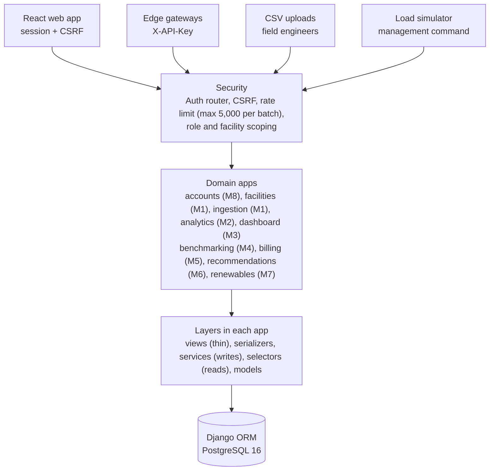
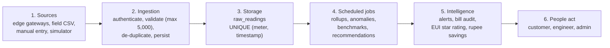

# GreenGrid: Smart Energy Management for Tomorrow's Needs (P02)

**Author:** Priyanshu  
**Project Type:** Individual Academic Project (90 Hours)  
**Repository:** [https://github.com/Priyanshu2068/mca2-fsdpython-greengrid.git](https://github.com/Priyanshu2068/mca2-fsdpython-greengrid.git)

---

## 1. Project Overview
GreenGrid is a web-based Energy Management Information System (EMIS) tailored for Indian commercial facilities. It collects 15-minute sub-metered energy readings (grid, diesel generators, solar PV, water, gas; categorised by HVAC, lighting, IT, and auxiliary pump loads) and converts high-frequency operational telemetry into actionable analytics, benchmarks, billing audit reconciliation, automated anomaly alerts, and rule-based energy conservation measures (ECMs) with rupee (₹) savings.

Meter hardware is out of scope. Data arrives via a high-throughput idempotent ingestion API supported by synthetic seed fixtures, a built-in load simulator, CSV batch uploads, and manual entry forms.

---

## 2. Technical Stack
- **Language & Runtime:** Python 3.11+
- **Backend Framework:** Django 4.2 LTS & Django REST Framework (DRF)
- **Frontend:** React 18 single-page app built with Vite (`frontend/`), talking to the REST API with same-origin session + CSRF auth
- **Database Engine:** PostgreSQL 16 using `psycopg 3`. Used in place of the MySQL suggested in the project brief, because ingestion, scheduled rollups and dashboards run concurrently, the data model relies on strict unique and foreign-key constraints, and the readings table is append-only time-series data that suits PostgreSQL's aggregation functions and BRIN indexes
- **Query & Storage Optimisation:** `ON CONFLICT` upserts, `date_trunc` aggregate rollups, BRIN indices on reading timestamps
- **API Documentation & Filtering:** `drf-spectacular` (OpenAPI 3.0 / Swagger UI at `/api/docs/`), `django-filter`
- **Authentication & Security:** Django built-in Session Authentication with strict CSRF protection (no JWT) and SHA-256 hashed device API keys (`X-API-Key`)
- **Background Orchestration:** Re-runnable Django management commands (modular, cron-friendly, no Celery/Redis dependencies)
- **Testing & Quality Assurance:** `pytest` and `pytest-django` with isolated database fixtures
- **Environment Management:** `django-environ` reading local `.env` files

---

## 3. System Design at a Glance

### 3.1 Architecture

GreenGrid is a modular monolith: one Django project made of nine focused apps on a shared core, with every app split into the same layers.



### 3.2 Data Workflow: From Meter Reading to Rupee Saved



Ingestion is idempotent: sending the same batch twice never double counts, because unique keys and `ignore_conflicts` reject duplicates at the database. Jobs are re-runnable management commands, so there is no message queue to operate.

### 3.3 Database Schema: 24 Tables in 8 Domains

| Domain | Tables |
| :--- | :--- |
| Access | `users_customuser`, `accounts_auditlog` |
| Facilities | `facility`, `building`, `meter`, `datasource`, `user_facility_assignment` |
| Ingestion | `ingestion_batchlog`, `ingestion_rawreading` |
| Analytics | `hourly_rollup`, `daily_rollup`, `anomaly_alert` |
| Benchmarking | `building_benchmark`, `facility_benchmark_score` |
| Billing | `utility_provider`, `tariff_structure`, `utility_bill`, `bill_reconciliation` |
| Recommendations | `ecm_rule`, `recommendation` |
| Renewables | `solar_asset`, `solar_generation_reading`, `grid_event`, `carbon_emission_factor` |

Facility is the root of the model: every query is scoped to the user's assigned facilities. The full ER diagram is in [`docs/er-diagram.md`](docs/er-diagram.md) and the DDL in [`database/schema.sql`](database/schema.sql).

### 3.4 What Makes GreenGrid Different

| Aspect | Typical EMIS tools | GreenGrid |
| :--- | :--- | :--- |
| Market focus | Generic, global dashboards | Built for Indian facilities: rupees, kVA demand, power-factor penalties, BEE benchmarks |
| Data intake | Tied to vendor hardware and gateways | Hardware-agnostic: REST API key, CSV upload, manual entry, simulator |
| Billing | Shows consumption only | Reconciles the utility bill against metered energy and flags variance above 2.5% |
| Insight | Charts and threshold alerts | Rule-based energy measures with rupee savings, payback and an accept / dismiss workflow |
| Operations | Heavy stack of queues and caches | Cron-friendly management commands. No Celery or Redis needed |
| Data quality | Duplicates cleaned up afterwards | Idempotent ingestion: unique keys in PostgreSQL block duplicates at the source |

"Typical EMIS tools" is a general characterisation of common commercial products, not a benchmark of any specific vendor.

### 3.5 How Recommendations Are Generated

Recommendations come from 5 fixed, deterministic rules in [`backend/recommendations/services.py`](backend/recommendations/services.py), not from AI or an external service. The command `python manage.py generate_recommendations` (also run by `seed_demo`) evaluates the rules for each facility and saves one recommendation per rule per facility. Re-running updates them instead of duplicating. The rule definitions are stored in the `ecm_rule` table.

| Rule | Does it look at real data? | How the savings are worked out |
| :--- | :--- | :--- |
| Peak shaving | Yes. It only fires if peak-hour energy is over 20% of the last 30 days' usage. | Floor area x 8.5 kWh/m² shifted x ₹2.50 |
| Power factor (APFC) | Partly. It uses the count of low power-factor alerts. | ₹1,80,000 if there are alerts, otherwise ₹95,000 |
| HVAC weekend setback | No. It always appears. | Floor area x 14.5 kWh/m² x ₹7.80 |
| Baseload reduction | No. It always appears. | Floor area x 6.8 kWh/m² x ₹7.50 |
| Diesel generator overlap | Partly. It uses the count of generator-grid clash alerts. | 5,200 kWh x ₹23.50, or ₹75,000 if there are no alerts |

Implementation costs and action-plan text are fixed in the code. The savings figures are rule-of-thumb estimates scaled by floor area, not values measured from a facility's own consumption.

---

## 4. Web Client (Frontend)

The `frontend/` directory contains a React 18 + Vite single-page application. In production Django serves the built bundle at `/app/`, so the UI and API share one origin and the session cookie and CSRF token work without extra CORS setup.

| Page | Route | What it shows |
| :--- | :--- | :--- |
| **Overview** | `#/overview` | Today's consumption, month-to-date, peak demand vs. sanctioned kVA, energy mix, load breakdown, 24-hour / 30-day trends |
| **Alerts** | `#/alerts` | Anomaly alerts with acknowledge / resolve / false-positive workflow |
| **Billing** | `#/billing` | Utility bills and bill-vs-metered reconciliation; admins and field engineers can record a bill manually for emergency or offline entry |
| **Benchmarking** | `#/benchmark` | EUI, BEE star rating, percentile and facility ranking (facilities you are not assigned to appear anonymously as "Peer facility #N") |
| **Recommendations** | `#/recs` | Energy conservation measures with ₹ savings; accept, dismiss or mark implemented |
| **Renewables & Carbon** | `#/solar` | Solar generation, self-consumption, emissions by source, grid outages |
| **Facilities** | `#/sites` | Facilities and meters; admins can add a facility, and admins and field engineers can register meters and upload CSV readings |
| **Users** | `#/users` | Admins and field engineers add users and choose which facilities they can see (admins: customers and field engineers; field engineers: customers for their own facilities). Admins can also deactivate users |

Features: role-aware login (admin, customer, field engineer), facility switcher, light/dark theme, and a responsive layout that works from phones to desktops. The dashboard, alerts, billing and renewables pages refresh themselves every 30 seconds while the tab is open (a "Live" indicator in the top bar shows the last update, and the refresh button updates immediately). Open forms and dialogs are not interrupted by a refresh.

All roles can view every page for their assigned facilities (admins see all facilities). What each role can *do* differs, and the backend enforces it:

| Action | Admin | Customer | Field engineer |
| :--- | :---: | :---: | :---: |
| View dashboards, billing, benchmarks, renewables | Yes | Yes | Yes |
| Acknowledge / resolve alerts | Yes | View only | Yes |
| Accept / dismiss recommendations | Yes | Yes | View only |
| Record a utility bill (manual / emergency entry) | Yes | No | Yes (assigned facilities) |
| Register meters, upload CSV readings | Yes | No | Yes |
| Add users and grant facility access | Yes (customers, field engineers) | No | Yes (customers, own facilities only) |
| Add a facility | Yes | No | No |
| Create buildings, deactivate users | Yes | No | No |
| Change own password (sidebar) | Yes | Yes | Yes |

```
frontend/
├── index.html
├── vite.config.js        # base /app/, dev proxy /api -> Django :8000
└── src/
    ├── main.jsx, App.jsx # entry, shell, hash routing
    ├── api.js            # fetch wrapper (session + CSRF)
    ├── hooks.js          # useAsync, useHashRoute
    ├── components/       # ui atoms, SVG charts, icons
    └── pages/            # one component per page above
```

### Adding Users and Granting Facility Access

Admins and field engineers can add users from the **Users** page. A temporary password is generated, shown once after the user is created, and cannot be retrieved later. Every grant and change is written to the audit log.

| | Admin | Field engineer |
| :--- | :--- | :--- |
| Roles they can create | Customers and field engineers | Customers only |
| Facilities they can grant | Any facility (optional) | Only their own, and at least one is required |
| Users they see in the list | Everyone | Customers who share one of their facilities |
| Edit someone's facility access | Yes | Yes, within their own facilities (access to other facilities is kept) |
| Deactivate a user | Yes | No |

---

## 5. Project Review & Evaluation Directory

This section provides direct navigation to project milestones, design artifacts, and architectural documentation for academic evaluation.

### Release Tags & Milestones
| Milestone Tag | Phase Scope | Focus Areas | Status |
| :--- | :--- | :--- | :--- |
| **`v0.1.0`** | Phase 0 | Architecture, Workflows, ERD, SQL DDL, API Spec, User Stories | Complete |
| **`v0.2.0`** | Phase 1 | Foundation, Ingestion API, Weather Simulator, Rollups, Anomalies | Complete |
| **`v0.3.0`** | Phase 2 | Executive Dashboard APIs, Utility Billing & Reconciliation, BEE Benchmarks | Complete |
| **`v1.0.0`** | Phase 3 | Recommendation Engine (ECMs), Renewables, Grid Outages & Carbon, Final Release | Complete |

### Design Documentation Index
All foundational engineering documents reside in the `docs/` and `database/` directories:

| Document | File Path | Description |
| :--- | :--- | :--- |
| **Operational Workflows** | [`docs/workflow.md`](docs/workflow.md) | Mermaid flowcharts for end-to-end ingestion, 15-minute reading validation, and role-based workflows |
| **System Architecture** | [`docs/architecture.md`](docs/architecture.md) | Component architecture, modular monolith app structure, layer conventions, authentication flows, and ADRs |
| **Entity-Relationship Model** | [`docs/er-diagram.md`](docs/er-diagram.md) | Complete Mermaid ER diagram illustrating relational structures, constraints, and cardinalities |
| **Relational Database DDL** | [`database/schema.sql`](database/schema.sql) | Production PostgreSQL 16 schema with table definitions, constraints, foreign keys, and BRIN indexes |
| **Seed Data Fixtures** | [`database/seed_data.sql`](database/seed_data.sql) | Comprehensive Indian commercial facility dataset (2024–2026) with master records, readings, and edge cases |
| **REST API Specification** | [`docs/api-spec.md`](docs/api-spec.md) | Comprehensive endpoint catalog covering all 8 modules, payload schemas, and response formats |
| **Agile Backlog & Stories** | [`docs/user-stories.md`](docs/user-stories.md) | Granular user stories (P02-US01 to P02-US23) with acceptance criteria, priority, and 90-hour work allocation |
| **Comprehensive Test Report** | [`docs/test-report.md`](docs/test-report.md) | Automated regression test execution report: 52 passing tests (100% pass rate) across all 8 modules |
| **Phase 0 Review** | [`docs/sprint-0-review.md`](docs/sprint-0-review.md) | Verification and design sign-off for Phase 0 (Tag `v0.1.0`) |
| **Phase 1 Review** | [`docs/sprint-1-review.md`](docs/sprint-1-review.md) | Verification report for Phase 1 Foundation, Ingestion & Analytics (Tag `v0.2.0`) |
| **Phase 2 Review** | [`docs/sprint-2-review.md`](docs/sprint-2-review.md) | Verification report for Phase 2 Dashboards, Utility Billing & Benchmarking (Tag `v0.3.0`) |
| **Phase 3 Review** | [`docs/sprint-3-review.md`](docs/sprint-3-review.md) | Verification report for Phase 3 Recommendations, Renewables & Release (Tag `v1.0.0`) |

---

## 6. Local Installation & Setup Guide

### Prerequisites
- Python 3.11 or higher
- PostgreSQL 16
- Node.js 18+ and npm (for the React frontend)
- Git

### Setup Steps
1. **Clone the Repository:**
   ```bash
   git clone https://github.com/Priyanshu2068/mca2-fsdpython-greengrid.git
   cd mca2-fsdpython-greengrid
   ```

2. **Set Up Python Virtual Environment:**
   ```bash
   python -m venv venv
   # On Windows (PowerShell):
   .\venv\Scripts\Activate.ps1
   # On Linux/macOS:
   source venv/bin/activate
   ```

3. **Install Dependencies:**
   ```bash
   pip install -r backend/requirements.txt
   ```

4. **Configure Environment Variables:**
   ```bash
   cp .env.example .env
   # Modify .env with your local PostgreSQL credentials (DATABASE_URL)
   ```
   Create the database first: `CREATE USER greengrid_user WITH PASSWORD 'greengrid_password' CREATEDB;` and `CREATE DATABASE greengrid_db OWNER greengrid_user;`.

5. **Initialize Database & Run Migrations** (from the repository root):
   ```bash
   python manage.py migrate
   ```

6. **Seed Demo Data** (facilities, meters, readings, bills, benchmarks, recommendations and demo users):
   ```bash
   python manage.py seed_demo
   ```
   Demo accounts (password `GreenGrid@123`): `admin@greengrid.test`, `customer@greengrid.test`, `engineer@greengrid.test`.
   Alternatively, load the raw SQL dataset: `psql -U greengrid_user -d greengrid_db -f database/seed_data.sql`.

7. **Build the Web Client:**
   ```bash
   cd frontend
   npm install
   npm run build
   cd ..
   ```

8. **Run the Development Server:**
   ```bash
   python manage.py runserver
   ```
   - Web app: `http://127.0.0.1:8000/app/`
   - Swagger UI: `http://127.0.0.1:8000/api/docs/`

   **Frontend hot-reload (optional):** with Django running on port 8000, run `npm run dev` in `frontend/` and open `http://localhost:5173/app/`. Vite proxies `/api` to Django.

9. **Execute Test Suite:**
   ```bash
   cd backend
   pytest
   ```
   With PostgreSQL, the database user needs the `CREATEDB` privilege so pytest can create a temporary test database.

10. **Run Background Analytics & Intelligence Jobs:**
   All background jobs run as deterministic, re-runnable Django management commands:
   ```bash
   # Recompute incremental 48-hour hourly rollups
   python manage.py rollup_hourly --hours-back 48

   # Recompute daily rollups with TOD peak/off-peak segregation
   python manage.py rollup_daily --days-back 30

   # Run automated anomaly detection engine
   python manage.py detect_anomalies

   # Calculate annual EUI and assign BEE Star Ratings
   python manage.py compute_benchmarks --year 2025

   # Generate deterministic ECM recommendations with ₹ savings
   python manage.py generate_recommendations

   # Generate simulated meter readings for a facility
   python manage.py run_simulator --facility-id 1 --days 7
   ```
