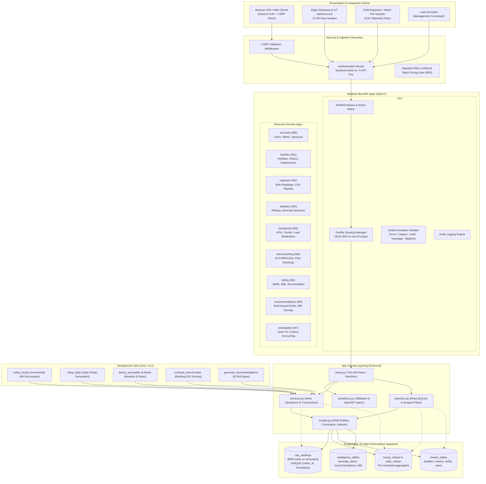

# GreenGrid Architecture & Technical Design Specification

This document outlines the architectural blueprint, module topology, layering standards, security and authentication mechanics, and Architectural Decision Records (ADRs) for the GreenGrid Energy Management Information System (EMIS).

---

## 1. High-Level Component Architecture

GreenGrid is architected as an enterprise-grade **Modular Monolith** built on Django 4.2 LTS, Django REST Framework, and PostgreSQL 16.



---

## 2. Django App Topology & Domain Modules

The codebase is partitioned into self-contained, loosely-coupled apps. Cross-app interaction is mediated via explicit service or selector functions.

| App Directory | Module Code | Scope & Responsibilities |
| :--- | :--- | :--- |
| `backend/core/` | Core | Shared abstractions, standard error handling, `RolePermission`, facility scoping filter backends, base models (`TimeStampedModel`), and pagination. |
| `backend/accounts/` | M8 | Custom user model (email-based login), RBAC (`admin`, `customer`, `field_engineer`), session lifecycle (`/login/`, `/logout/`, `/me/`, `/change-password/`), CSRF bootstrap endpoint, audit logs. |
| `backend/facilities/`| M1 | Master entities: `Facility`, `Building`, `Meter` (type, unit, load category: HVAC, lighting, IT, pumps; energy source: grid, DG, solar, water, gas), `DataSource` with API-key management. |
| `backend/ingestion/` | M1 | Telemetry ingestion: `/api/v1/ingestion/readings/bulk/`, validation engine, CSV batch file processing, idempotent persistence. |
| `backend/analytics/` | M2 | Processing engine: `rollup_hourly`, `rollup_daily`, 4-week hour-of-week median anomaly detector, `AnomalyAlert` lifecycle. |
| `backend/dashboard/` | M3 | Fast analytical read endpoints (<1s): Executive KPIs, 24-hour/30-day trends, energy mix, and sub-metered load breakdown (reads rollups only). |
| `backend/benchmarking/`| M4 | Indian commercial building benchmarking: Energy Use Intensity (EUI in $\text{kWh/m}^2/\text{year}$), building type standards, ranking distributions. |
| `backend/billing/` | M5 | Commercial electricity tariffs (slabs, peak charges, demand kW, PF penalties), utility bill recording, cost per kWh, and metered vs. billed reconciliation. |
| `backend/recommendations/`| M6 | Deterministic Energy Conservation Measures (ECMs) evaluating baseline waste, power factor penalties, and operational schedules with ₹ savings; accept/dismiss workflows. |
| `backend/renewables/` | M7 | Solar PV arrays, generation logging, self-consumption percentage calculation, grid outage tracking, and grid vs. DG vs. solar carbon footprint accounting. |

---

## 3. Mandatory Layer Rules

Every domain app strictly adheres to an 8-layer architecture. Circular imports and leaky abstractions are strictly disallowed.

```
<app_name>/
├── models.py               # Pure schema, constraints, DB indexes, model clean()
├── services.py             # Business logic, write transactions, mutations
├── selectors.py            # Read queries, filters, aggregations, scoping
├── serializers.py          # Input validation, output schema formatting
├── views.py                # Thin DRF ViewSets / APIViews
├── urls.py                 # Endpoint routing under /api/v1/<app_name>/
├── management/commands/    # Scheduled CLI entrypoints (thin callers of services)
└── tests/                  # App-isolated pytest test suites
```

### Layer Responsibilities & Constraints
1. **`models.py`:**
   - Defines database tables, field types, constraints (`CheckConstraint`, `UniqueConstraint`), and indexes (`BRIN`, `BTree`).
   - All timestamps stored in UTC (`DateTimeField(auto_now_add=True)`).
   - All monetary values and energy quantities use `DecimalField(max_digits=14, decimal_places=4)`—floating point types are forbidden for financial or billing metrics.
   - Models must never invoke external APIs or execute business calculations.
2. **`services.py`:**
   - Sole location for write operations (`create`, `update`, `delete`, batch inserts).
   - Encapsulates database transactions via `transaction.atomic()`.
   - Executes domain logic, calculates ₹ savings, and raises application domain errors.
3. **`selectors.py`:**
   - Sole location for query sets, joins, and database aggregations (`Sum`, `Avg`, `date_trunc`).
   - Applies facility tenancy filtering so out-of-scope objects are omitted or raise `ObjectDoesNotExist`.
   - Never modifies database state.
4. **`serializers.py`:**
   - Translates HTTP payloads to validated Python data structures.
   - Enforces batch constraints (e.g. batch size $\le 5000$).
   - Annotates OpenAPI metadata via `drf-spectacular` `@extend_schema_serializer`.
5. **`views.py`:**
   - Extremely thin coordination layer.
   - Authenticates request, checks `RolePermission`, calls `serializers` to validate, passes validated data to `services.py` (for writes) or `selectors.py` (for reads), and returns formatted `Response`.
6. **`management/commands/`:**
   - Command-line interfaces for cron-based background jobs (`rollup_hourly`, `detect_anomalies`).
   - Must contain zero business logic; acts purely as an execution trigger for `services.py` functions with standard error and output logging.

---

## 4. Authentication, Authorization & Security Architecture

### Authentication Flows

```mermaid
sequenceDiagram
    autonumber
    actor Web as Web Browser User (Customer / Admin)
    actor Edge as IoT Gateway / Ingestion Script
    participant API as GreenGrid Backend API (/api/v1/)
    participant Auth as Session & CSRF Security Engine
    participant DB as PostgreSQL 16 Datastore

    Note over Web, DB: Flow A: Web User Session Authentication
    Web->>API: GET /api/v1/accounts/csrf/
    API-->>Web: Set-Cookie: csrftoken=<TOKEN>; 200 OK
    Web->>API: POST /api/v1/accounts/login/ {email, password} + X-CSRFToken
    API->>Auth: Validate credentials (Argon2 / PBKDF2)
    Auth->>DB: Fetch user record & role
    Auth-->>Web: Set-Cookie: sessionid=<SESSION_ID>; 200 OK {user profile}
    Web->>API: GET /api/v1/dashboard/kpis/ + Cookie: sessionid
    API->>DB: Query scoped facilities for user
    API-->>Web: 200 OK {KPI metrics}

    Note over Edge, DB: Flow B: Device Ingestion via X-API-Key
    Edge->>API: POST /api/v1/ingestion/readings/bulk/ + Header: X-API-Key: gg_live_xxx
    API->>Auth: Compute SHA-256(gg_live_xxx)
    Auth->>DB: SELECT * FROM facilities_datasource WHERE key_hash = :hash
    DB-->>Auth: DataSource (Facility: Alpha Tech Park, is_active: true)
    API->>DB: Bulk insert readings (ON CONFLICT DO NOTHING)
    API-->>Edge: 201 Created {accepted: 96, duplicates: 0, rejected: 0}
```

### Authorization & Tenancy Scoping
- **`RolePermission`:** Each API view specifies a role-action permission map:
  ```python
  role_permissions = {
      'admin': ['list', 'retrieve', 'create', 'update', 'destroy'],
      'customer': ['list', 'retrieve'],
      'field_engineer': ['list', 'retrieve', 'create']
  }
  ```
- **Facility Tenancy Scoping:**
  - `admin`: Global access across all organizations and facilities.
  - `customer`: Strict filtering to facilities owned by their organization.
  - `field_engineer`: Strict filtering to explicitly assigned facilities.
  - Attempts to access unassigned facilities return `HTTP 404 Not Found` rather than `403 Forbidden` to prevent object enumeration.
- **Role-specific actions (enforced in the API, mirrored in the UI):**
  - Alerts can be acknowledged or resolved by `admin` and `field_engineer`; `customer` is view-only.
  - Recommendations can be accepted or dismissed by `admin` and `customer`; `field_engineer` is view-only.
  - Utility bills can be recorded manually (emergency or offline entry) by `admin` and `field_engineer`; engineers only for their assigned facilities.
  - Users and facility access: `admin` creates customers and field engineers; `field_engineer` creates customers for their own facilities only. Only `admin` deactivates users or adds facilities.
  - Peer ranking: a user sees their own facilities in full; every other facility is anonymised as `Peer facility #N` (EUI, percentile and star rating remain for comparison). Admins see everything.

### Deployment View
The repository ships a production-style container setup (`Dockerfile`, `docker-compose.yml`, `nginx.conf`, `docker-entrypoint.sh`). `docker compose up --build` starts three services: **db** (PostgreSQL 16 with a persistent volume), **web** (Django and DRF serving the compiled React client) and **nginx** (reverse proxy and static files). The same code runs unchanged in local development with `manage.py runserver` and `npm run dev`.

---

## 5. Architectural Decision Records (ADRs)

| ADR ID | Decision Title | Status | Alternatives Rejected | Rationale & Architectural Justification |
| :--- | :--- | :--- | :--- | :--- |
| **ADR-01** | Modular Monolith Architecture | **Accepted** | Microservices Architecture | A single deployable unit eliminates distributed network latency, cross-service transactions, and operational complexity, while maintaining strict domain modularity via Django apps. |
| **ADR-02** | PostgreSQL 16 with BRIN Indexes & ON CONFLICT | **Accepted** | TimescaleDB, InfluxDB, MongoDB | Native PostgreSQL 16 meets all throughput requirements using Block Range Index (BRIN) on timestamps (consuming 95% less disk space than B-tree for append-mostly time series) and native `ON CONFLICT (meter_id, timestamp) DO NOTHING` for idempotent ingestion. Avoids proprietary extensions. |
| **ADR-03** | Django Session Auth + CSRF for Web | **Accepted** | JSON Web Tokens (JWT) in localStorage | Built-in session authentication provides robust server-side invalidation, immunity against XSS token exfiltration, and eliminates complex JWT refresh token rotation mechanics. Devices use hashed API keys. |
| **ADR-04** | Django Management Commands for Scheduled Jobs | **Accepted** | Celery + Redis / RabbitMQ | Energy rollups, anomaly scans, and benchmark runs are periodic batch operations rather than asynchronous task queues. Simple cron invocation of management commands eliminates Redis/Celery broker maintenance and infrastructure overhead. |
| **ADR-05** | Service & Selector Pattern | **Accepted** | Fat Models / Fat Views | Separating business mutations (`services.py`) and read-only query logic (`selectors.py`) keeps views declarative and thin, decouples business rules from Django ORM hooks, and makes automated testing straightforward. |
| **ADR-06** | Incremental 48-Hour Upsert Rollups | **Accepted** | Real-time Ad-hoc Queries on Raw Tables | Querying millions of 15-minute raw rows on dashboard page loads would breach the 1-second response constraint. Incremental rollups recomputing the last 48 hours ensure backfilled or delayed readings are absorbed while keeping queries instantaneous. |
| **ADR-07** | Unified Error Envelope Standard | **Accepted** | Default Django HTML/DRF inconsistent dictionaries | All HTTP 4xx and 5xx responses conform to `{"error": {"status": int, "code": str, "message": str, "details": dict}}`. Provides predictable client error parsing and seamless frontend integration. |
