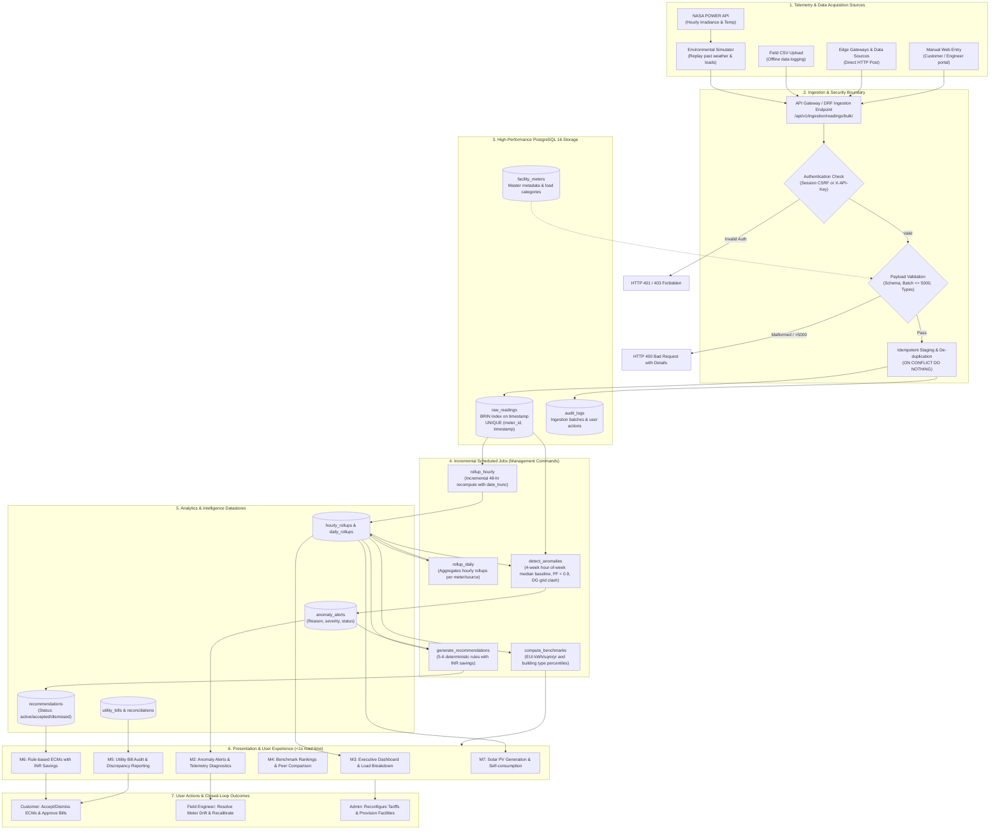
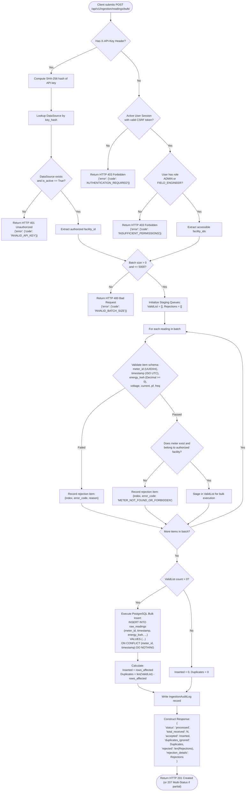

# GreenGrid Operational Workflows Specification

This document details the system workflows for GreenGrid, covering end-to-end telemetry flow, the idempotent 15-minute ingestion lifecycle, and role-specific operational user journeys.

---

## 1. End-to-End System Flow

The diagram below illustrates the comprehensive lifecycle of energy data—from external sources and simulation scripts through ingestion, storage, scheduled analytical rollups, and user-facing intelligence interfaces.

---

## 2. 15-Minute Reading Ingestion & Validation Workflow

Every 15-minute telemetry packet undergoes rigorous syntax, security, and integrity checks prior to persistence. Idempotency guarantees that re-transmitting payloads will never duplicate metrics or corrupt downstream aggregates.

---

## 3. Per-Role Operational Workflows

GreenGrid enforces strict Role-Based Access Control (RBAC) across three distinct user personas: **Administrator**, **Customer**, and **Field Engineer**.

```mermaid
flowchart TD
    subgraph AdminWF["Administrator Workflow (System Governance)"]
        A_Start(["Admin Logs In"]) --> A_Mgt["User Management\n(Create Customer / Engineer accounts)"]
        A_Mgt --> A_Fac["Facility & Sub-meter Provisioning\n(Assign square footage, load categories, building types)"]
        A_Fac --> A_Tariff["Utility Tariff Configuration\n(Define slabs, peak hours, demand charges, PF penalties)"]
        A_Tariff --> A_Audit["System Audit & Anomaly Tuning\n(Configure thresholds, review system ingestion health)"]
    end

    subgraph CustomerWF["Customer Workflow (Facility Energy Management)"]
        C_Start(["Customer Logs In"]) --> C_Scope["System scopes view to\nauthorized facilities only"]
        C_Scope --> C_Dash["View Real-time Executive Dashboard\n(<1s load from pre-aggregated rollups)"]
        C_Dash --> C_DeepDive{"User Action"}
        C_DeepDive -- "Monitor Mix" --> C_Mix["Inspect Energy Mix\n(Grid, Solar, DG, Gas breakdown)"]
        C_DeepDive -- "Billing Audit" --> C_Bill["Review Monthly Utility Bill\n(Metered vs. Billed variance report)"]
        C_DeepDive -- "Benchmarks" --> C_Bench["Compare Energy Use Intensity (EUI)\nagainst Indian building benchmarks"]
        C_DeepDive -- "ECMs" --> C_Rec["Review Rule-based Recommendations\n(Evaluate ₹ savings per year)"]
        C_Rec --> C_Action{"Decision"}
        C_Action -- "Approve" --> C_Accept["Mark Recommendation 'ACCEPTED'\n(Schedule maintenance/retrofit)"]
        C_Action -- "Dismiss" --> C_Dismiss["Mark Recommendation 'DISMISSED'\n(Store dismissal justification)"]
    end

    subgraph FieldEngWF["Field Engineer Workflow (Operations & Field Deployment)"]
        F_Start(["Field Engineer Logs In"]) --> F_Scope["Scope limited to\nassigned facilities"]
        F_Scope --> F_Action{"Operational Task"}
        F_Action -- "Register Hardware" --> F_Meter["Register New Meter\n(Assign serial number, load type, source)"]
        F_Meter --> F_Key["Generate or Rotate DataSource API Key\n(Copy unhashed secret once, SHA-256 stored)"]
        F_Action -- "Offline Ingestion" --> F_Upload["Upload Historical CSV Readings\n(Validate headers, progress tracking)"]
        F_Upload --> F_ErrReview["Review Ingestion Error Log\n(Fix timestamp offsets, re-upload)"]
        F_Action -- "Diagnostics" --> F_Alerts["Inspect Anomaly Alerts\n(PF < 0.9, meter silent > 2h, DG clash)"]
        F_Alerts --> F_Ack["Acknowledge & Clear Field Alerts"]
    end
```

